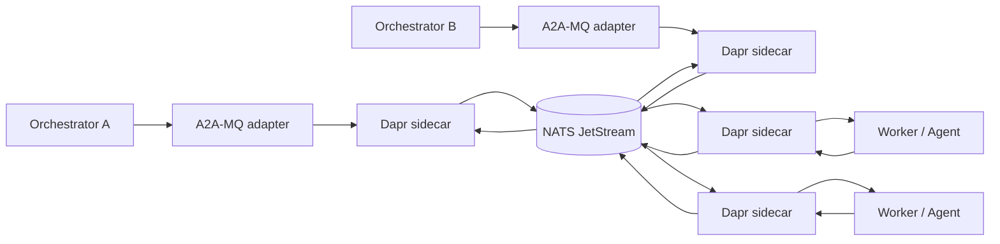

# A2A-MQ

A2A-MQ is a design and reference implementation for **durable, queue-native Agent2Agent (A2A) communication**.

The project explores a simple idea: keep the A2A data model and task lifecycle, but let orchestrators and agent workers exchange work through a durable message bus instead of requiring every interaction to be a direct HTTP/gRPC call.

> Status: **architecture / specification phase**. This repository intentionally starts with a complete design, requirements, protocol profile, security model, workflows, and implementation plan before production code.

## Why this project exists

A message broker is a natural fit for autonomous and long-running agent workloads:

- producers and consumers remain decoupled;
- workers can be offline and resume later;
- multiple replicas can compete for work;
- multiple orchestrators can fan out events;
- retries, back-pressure and dead-letter handling are infrastructure concerns rather than agent logic;
- tasks and results can be routed by agent, capability, tenant or role;
- sensitive payloads can optionally be encrypted end-to-end so the broker does not need plaintext access.

A2A 1.0 explicitly supports custom protocol bindings. A2A-MQ therefore aims to stay compatible with the canonical A2A model rather than inventing a second agent protocol.

## Foundation decision

The reference stack is:

- **A2A 1.0 semantics** (validated against the A2A 1.0.1 specification release);
- **Dapr Agents / Dapr Workflows** for durable agent execution and orchestration;
- **Dapr Pub/Sub** as the broker abstraction;
- **NATS JetStream** as the default reference broker;
- **SQLite for local workflow state** and PostgreSQL/Redis as production-ready state-store options;
- **OpenTelemetry** for tracing and metrics;
- optional **AES-GCM envelope encryption** for payload confidentiality beyond transport/topic ACLs.

This is deliberately not a new broker, workflow engine, agent framework, service mesh, or identity system. Dapr and JetStream already solve those problems well. The project-specific value is the **A2A-to-message-bus mapping, routing profile, security envelope, conformance layer, and developer ergonomics**.

## High-level architecture

Command subjects/topics use **competing-consumer semantics** when exactly one worker should execute a task. Event subjects/topics use **fan-out semantics** when multiple orchestrators, audit consumers, or observers should receive state changes.

## Design principles

1. **A2A first.** Preserve A2A task, message, artifact, context and error semantics.
2. **At-least-once delivery, idempotent processing.** Never claim magical end-to-end exactly-once execution.
3. **Static routing topology.** Do not create a broker topic per task; correlate using IDs inside the envelope.
4. **Broker portability.** Application code talks to Dapr Pub/Sub, not directly to JetStream APIs in the MVP.
5. **Security in layers.** Identity + topic ACLs + TLS by default; optional payload encryption for stronger isolation.
6. **Do not rebuild Dapr Agents.** Reuse durable workflows, agent runners, retries, state and observability.
7. **Conformance before branding.** The MVP is an A2A-compatible MQ profile; it should only advertise itself as a formal A2A custom binding after all required operations and interoperability tests pass.

## Documentation

The architecture branch contains the complete design set:

- `docs/WHITEPAPER.md` — research paper / technical proposal
- `docs/REQUIREMENTS.md` — functional and non-functional requirements with acceptance criteria
- `docs/ARCHITECTURE.md` — components, deployment topology and routing model
- `docs/PROTOCOL.md` — A2A-to-MQ operation mapping and envelope semantics
- `docs/WORKFLOWS.md` — sequence diagrams for the main task lifecycles
- `docs/SECURITY.md` — threat model, ACLs, identities, encryption and key rotation
- `docs/IMPLEMENTATION_PLAN.md` — phased build plan with explicit gates
- `docs/TEST_PLAN.md` — conformance, failure, durability and security test matrix
- `docs/OPERATIONS.md` — deployment and SRE guidance
- `docs/adr/` — architecture decision records
- `spec/` — machine-readable envelope schema
- `deploy/` — reference Dapr/JetStream configuration

## Scope of the first implementation

The MVP will support:

- message/task submission;
- asynchronous task status and artifact events;
- `GetTask`, `ListTasks` and `CancelTask` semantics;
- interrupted states (`INPUT_REQUIRED`, `AUTH_REQUIRED`) and continuation;
- retries and dead-letter handling;
- worker pools and multiple orchestrators;
- capability/agent routing;
- idempotent consumption;
- optional encrypted payloads;
- local Docker/Dapr deployment;
- an A2A HTTP bridge so standard A2A clients can interoperate with MQ-backed agents.

Streaming, push-notification configuration, formal custom-binding advertisement, multi-broker certification and advanced key distribution are staged behind the MVP conformance gate.

## Upstream references

Primary sources used for the design include:

- A2A protocol: https://a2a-protocol.org/latest/specification
- A2A custom protocol bindings: https://a2a-protocol.org/latest/topics/custom-protocol-bindings/
- A2A project releases: https://github.com/a2aproject/A2A/releases
- Experimental A2A SLIMRPC binding: https://github.com/a2aproject/experimental-cpb-slimrpc
- Dapr Agents: https://docs.dapr.io/developing-ai/dapr-agents/
- Dapr Agents core concepts: https://docs.dapr.io/developing-ai/dapr-agents/dapr-agents-core-concepts/
- Dapr Workflow: https://docs.dapr.io/developing-applications/building-blocks/workflow/workflow-overview/
- Dapr Pub/Sub JetStream component: https://docs.dapr.io/reference/components-reference/supported-pubsub/setup-jetstream/
- Dapr Pub/Sub access scopes: https://docs.dapr.io/developing-applications/building-blocks/pubsub/pubsub-scopes/
- Dapr security: https://docs.dapr.io/concepts/security-concept/

## Current conclusion

The problem is useful, but the right project is **not** “RabbitMQ rewritten for agents.” Dapr Agents already supplies most of the durable multi-agent runtime that would otherwise need to be built. A2A-MQ should be a thin, well-specified interoperability and secure-routing layer on top of mature infrastructure.
