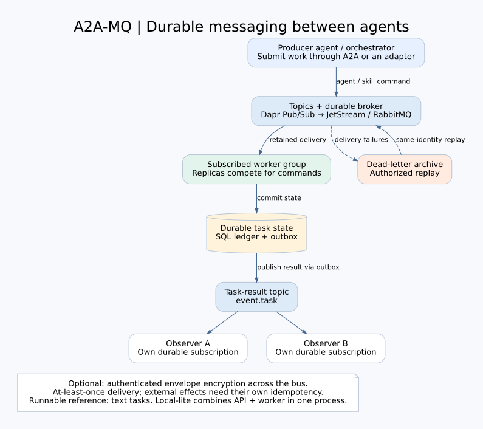

# A2A-MQ

**Durable messaging for agents: publish work, subscribe to topics, follow results.**

A2A-MQ helps agents and orchestrators exchange asynchronous work through a queue.
Commands target an agent or a skill; subscribed workers process them, and independent
observers receive task results. A2A supplies the task vocabulary, Dapr the Pub/Sub
boundary, and NATS JetStream or RabbitMQ the broker. Python is the reference
implementation, not a requirement on every A2A client.

Retained delivery lets a producer submit work while a worker is unavailable.
Stable identities, durable state and replay make retries recoverable. An optional
[authenticated payload-encryption profile](docs/PAYLOAD_PROTECTION.md) protects
messages between publishing and receiving applications across the broker; it is
not enabled in Local-lite and does not encrypt SQL or Workflow history.



The core supports agent/skill routes and separately configured consumers. The
ready-to-run A2A service is a deterministic Echo/Uppercase reference with a configured
agent target, not a dynamic agent registry or a demonstrated LLM-agent deployment.

This is an experimental engineering portfolio project, version **0.1.0**. It is an
A2A implementation with a custom queue envelope, not ACP or a new messaging standard.
It does not claim customers, production certification or arbitrary exactly-once
external effects. No license grant is supplied. Public-exposure review is tracked
separately in the [Publication checklist](docs/PUBLICATION.md).

## Try the messaging path

The default Local-lite runtime uses exactly three product processes on Linux:

```text
Producer / official A2A client
        │ JSON-RPC, REST or SSE
        ▼
Python A2A-MQ app ── SQLite task ledger, inbox/outbox, Queue Lab
        │ Dapr Pub/Sub
        ▼
      daprd ── NATS JetStream ── delivery back to the app's reference worker
```

The deterministic worker supports Echo and Uppercase without a model, API key or
paid call. It is a reference consumer, not a demonstrated customer workflow.
The local app and worker share a process. Independently scalable workers belong to
the separate distributed profile.

```bash
git clone https://github.com/rodhayl/A2A_MQ.git
cd A2A_MQ
python3 -m venv .venv
. .venv/bin/activate
python -m pip install -c requirements/portfolio-constraints.txt -e '.[local]'
python -m pip check
python scripts/bootstrap_local_tools.py --output .local-validation/tools
python scripts/check_local_native_versions.py \
  --daprd .local-validation/tools/bin/daprd \
  --nats-server .local-validation/tools/bin/nats-server \
  --bootstrap-manifest .local-validation/tools/manifest.json \
  --json .local-validation/native-versions.json
python scripts/portfolio_demo.py \
  --tools-bin .local-validation/tools/bin \
  --work-dir .local-validation/portfolio-demo \
  --output .local-validation/portfolio-demo.json
```

The demo follows submitted work through the real queue and checks its retained result.
It then verifies task recovery after a deliberate process interruption. It creates
a fresh private profile, stops its own app at a named admission/ACK boundary,
restarts it, and requires actual broker redelivery with one terminal record.
It also verifies duplicate and conflicting IDs, cancels paused work, and exercises
real DLQ archival and authorized replay with observed receipt and acknowledgement. It
runs a separate official SDK client and records a small, scoped latency sample.
Existing profile/report paths are never overwritten. Read the
[demo guide](docs/PORTFOLIO_DEMO.md) for requirements, safety and exact limits.
The injected crash is a test step; `status=PASS` requires the recovery checks to
succeed. An unmet check produces `status=FAIL` and a nonzero exit code.

For the browser console, use the [Getting Started](docs/GETTING_STARTED.md) guide.
Open `http://127.0.0.1:18000/lab/` only while your local runtime is running. Profile
files include signing keys and tokens: keep them private and outside commits.

## See encrypted topics and independent subscribers

The [native agent-bus demonstration](docs/AGENT_BUS_DEMO.md) sends a protected
command through real Dapr/NATS to a separate deterministic worker, then delivers
its protected result events to two independent observers. It inspects actual broker
bytes, tests rejected messages, and brings an offline observer back online.

It reuses the existing `[local]` environment and verified native tools. Development
keys stay in a disposable private fixture. This is a library-component integration
proof; the public A2A API, full ServiceApplication and Vault profile are separate.

## Engineering decisions worth inspecting

- Agent/skill topic routing, competing workers and independent result observers
- Optional AES-256-GCM envelope protection with Vault Transit key wrapping
- Immutable message identity and content-conflict detection, scoped by tenant/consumer
- SQL ledger, inbox/outbox, terminal guards and fenced distributed execution
- Durable admission before asynchronous execution; explicit cancellation semantics
- Verified-principal authorization; payload fields never authorize a caller
- Archived dead letters and explicit, identity-preserving replay
- Public A2A bindings implemented by the official SDK; internal envelope kept separate
- Low-footprint local profile with Workflow-only features rejected explicitly

A queue gives at-least-once delivery. SQL protections cover the declared local
transactional boundary. Email, payment and other external effects still need a
stable destination idempotency key or reconciliation.

## Pick the right profile

| Profile | Purpose | Infrastructure |
| --- | --- | --- |
| Local-lite | Immediate reference tasks, recovery demo and Queue Lab | Python, native Dapr/NATS, SQLite |
| Local Workflow | Durable waits, continuation, approval and timers | Local-lite plus Dapr Placement/Scheduler |
| Distributed | Separate API/worker/operations roles | PostgreSQL, Dapr Workflow, JetStream or RabbitMQ; optional Vault/telemetry |

For a simple synchronous request, ordinary HTTP may be easier to operate. This
project is useful when asynchronous handoff, offline workers, independent consumers
and durable task results matter. Recovery checks make those boundaries inspectable.

## Evidence and limits

Start with [Current status](docs/STATUS.md), the
[compatibility matrix](docs/COMPATIBILITY.md) and the
[validation evidence index](docs/VALIDATION.md).
Each result identifies its source/profile. Older RC2, Kubernetes and resource
records remain historical; they do not certify the current candidate.

`productionCertified=false` and `upstreamBindingCertified=false`. Repository
verdict names are test labels, not external certifications. No SLA, general
throughput claim, Windows-native support claim or exactly-once external guarantee
is implied.

## Documentation and development

- [Documentation map](docs/README.md)
- [Architecture and editable diagrams](docs/ARCHITECTURE.md) and [protocol](docs/PROTOCOL.md)
- [Payload protection: activation and trust boundaries](docs/PAYLOAD_PROTECTION.md)
- [API examples](docs/API_EXAMPLES.md) and [configuration](docs/CONFIGURATION.md)
- [Operations](docs/OPERATIONS.md), [deployment](docs/DEPLOYMENT.md), [security model](docs/SECURITY.md)
- [Contributing](CONTRIBUTING.md), [security reporting](SECURITY.md), [changelog](CHANGELOG.md)
