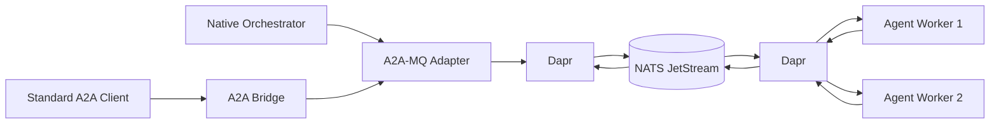

# A2A-MQ

A2A-MQ is a design and reference implementation for **durable, queue-native Agent2Agent (A2A) communication**.

The idea is simple: preserve A2A messages, tasks, artifacts and lifecycle semantics while allowing orchestrators and agent workers to exchange work through a durable message bus instead of requiring every interaction to be a live direct HTTP/gRPC call.

> Status: **architecture/specification complete; implementation not started yet.**

## Reference architecture

The selected foundation is:

- **A2A 1.0 semantics**, checked against the A2A v1.0.1 protocol definitions;
- **Dapr Agents / Dapr Workflow** for durable agent execution and orchestration;
- **Dapr Pub/Sub** as the broker abstraction;
- **NATS JetStream** as the default reference broker;
- a Dapr-supported durable state store for workflow/task projections (SQLite/local for development; production backend selected during implementation);
- **OpenTelemetry** for tracing/metrics;
- optional **AES-256-GCM envelope encryption** with per-message content keys and KMS-style key wrapping.

This project is deliberately **not** a new broker, workflow engine, identity system or agent framework. Its value is the A2A-to-message-bus protocol mapping, routing model, task correlation, secure envelope, conformance layer, bridge and developer tooling.

Commands use competing-consumer semantics when one worker should execute a task. Task/artifact events use independent subscriptions when multiple orchestrators or observers should see the same state changes.

## Core principles

1. Preserve upstream A2A semantics rather than creating a second agent protocol.
2. Use **at-least-once delivery + idempotent processing**; do not claim generic end-to-end exactly-once side effects.
3. Keep broker topology low-cardinality: correlate using IDs inside the envelope rather than creating one topic per task.
4. Keep application code behind Dapr/A2A-MQ APIs rather than binding it directly to JetStream.
5. Layer security: identity + topic ACLs + TLS, with optional payload encryption when broker-visible plaintext is unacceptable.
6. Reuse Dapr's workflows, state, resiliency and telemetry instead of rebuilding them.
7. Expose a standard A2A bridge first; only advertise a formal custom MQ binding after its conformance gate passes.

## Design package

- [`docs/WHITEPAPER.md`](docs/WHITEPAPER.md) — paper-style technical proposal and rationale
- [`docs/FOUNDATION_RESEARCH.md`](docs/FOUNDATION_RESEARCH.md) — alternatives matrix and foundation decision
- [`docs/REQUIREMENTS.md`](docs/REQUIREMENTS.md) — traceable functional/non-functional requirements and release gates
- [`docs/ARCHITECTURE.md`](docs/ARCHITECTURE.md) — components, data planes, routing, HA and deployment topology
- [`docs/PROTOCOL.md`](docs/PROTOCOL.md) — A2A-to-MQ operations, envelope, lifecycle and conformance rules
- [`docs/WORKFLOWS.md`](docs/WORKFLOWS.md) — Mermaid workflows for normal, failure, cancellation, encryption and multi-orchestrator cases
- [`docs/SECURITY.md`](docs/SECURITY.md) — threat model, authorization, envelope encryption and key rotation
- [`docs/IMPLEMENTATION_PLAN.md`](docs/IMPLEMENTATION_PLAN.md) — phased build plan with explicit exit gates
- [`docs/TEST_PLAN.md`](docs/TEST_PLAN.md) — conformance, reliability, chaos, performance and security tests
- [`docs/OPERATIONS.md`](docs/OPERATIONS.md) — retention, DLQ, alerts, graceful shutdown and recovery
- [`docs/adr/`](docs/adr/) — architecture decision records
- [`spec/envelope.schema.json`](spec/envelope.schema.json) — machine-readable versioned envelope schema
- [`deploy/`](deploy/) — initial Dapr/JetStream deployment guidance

## MVP scope

The first implementation is designed to prove:

- durable message/task submission even with offline workers;
- multiple worker replicas with competing consumption;
- multiple orchestrators observing task events independently;
- A2A `GetTask`, `ListTasks`, cancellation and interrupted-state continuation;
- durable `INPUT_REQUIRED` / `AUTH_REQUIRED` workflows;
- retries, redelivery, idempotency and DLQ behavior;
- task and artifact persistence/query;
- standard A2A client interoperability through the bridge;
- topic/workload authorization;
- optional broker-opaque encrypted payloads;
- OpenTelemetry traces/metrics;
- broker portability demonstrated later with a second Dapr backend (preferred: RabbitMQ).

## Why this is useful

A broker-native transport is useful for long-running autonomous work because producers and consumers remain decoupled, workers may be unavailable temporarily, load can be balanced across replicas, events can fan out to many orchestrators, and retry/back-pressure/dead-letter behavior becomes explicit infrastructure rather than ad-hoc agent logic.

The architecture study concluded that most of the hard infrastructure already exists. The useful missing piece is **A2A-aware durable messaging glue**, not another RabbitMQ.

## Primary upstream references

- A2A specification: https://a2a-protocol.org/latest/specification/
- A2A custom protocol bindings: https://a2a-protocol.org/latest/topics/custom-protocol-bindings/
- A2A project: https://github.com/a2aproject/A2A
- Dapr Agents: https://docs.dapr.io/developing-ai/dapr-agents/
- Dapr Workflow: https://docs.dapr.io/developing-applications/building-blocks/workflow/workflow-overview/
- Dapr JetStream Pub/Sub component: https://docs.dapr.io/reference/components-reference/supported-pubsub/setup-jetstream/
- Dapr Pub/Sub scopes: https://docs.dapr.io/developing-applications/building-blocks/pubsub/pubsub-scopes/
- Dapr security: https://docs.dapr.io/concepts/security-concept/
- NATS JetStream: https://docs.nats.io/nats-concepts/jetstream
