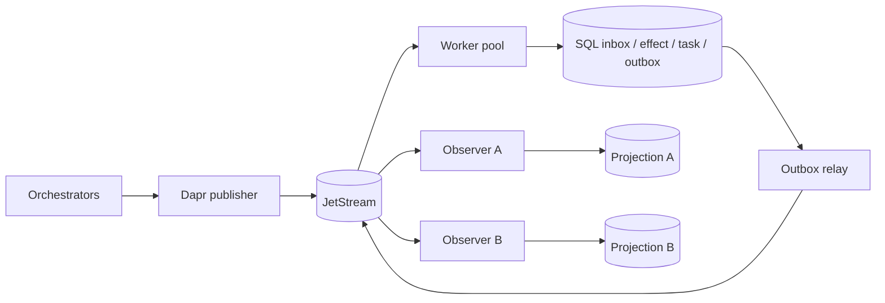

# Architecture - revision 3

## Product principle: local footprint first

A2A-MQ has two different deployment concerns and they must not be conflated.

The **local bridge** must be cheap enough to leave running beside models and agent
tools on a resource-constrained machine. The **distributed profile** may use the
heavier services required for shared durability, HA and independent scaling.

Resource viability is therefore a product gate. See ADR 0011 and
`scripts/local_resource_probe.py`. The complete Docker/Compose/Kubernetes stack is
an acceptance/distributed topology, not the default local runtime.

### Target deployment tiers

**Core diagnostic** is Python + SQLite only. It proves our own code is lightweight,
but does not claim Dapr/MQ parity.

**Local MQ Lite target** is one application process, SQLite application state, one
native Dapr sidecar and one native single-node JetStream broker. Docker, PostgreSQL,
Redis, Vault and an external telemetry collector are not default prerequisites.
Workflow-only capabilities may be disabled in this tier.

**Local Workflow target** adds only the minimum Dapr Actor/Workflow services needed
for durable Workflow semantics. Prefer a local Dapr SQLite state store where the
supported Dapr component contract permits it. Placement/Scheduler cost must be
measured independently before this tier becomes the default.

**Distributed/production** retains role separation, shared PostgreSQL, production
broker/state stores, HA, workload security and operational infrastructure.

The current integrated `a2a_mq.application` still assumes a colocated Dapr sidecar
and exposes separate roles. It is not yet evidence that the Local MQ Lite target has
been achieved. That gap is explicit rather than hidden behind a full local stack.

## Boundaries and ownership

Dapr provides the Pub/Sub API. JetStream provides retained delivery. Our SQL
transaction provides the application consistency boundary. These are different
promises: neither a broker ACK nor a Dapr sidecar proves a business effect occurred.
Dapr Workflow is used by the Workflow tier/distributed profile; the lightweight
local tier must not silently pay for it when those semantics are disabled.

The worker pool is one logical task authority. Replicas share its database and
consumer namespace. A claim contains a lease and fencing token; recovery may
reclaim an abandoned claim, but a stale worker cannot commit through the old token.
A task's owner/source and context cannot change silently.

## Transaction and ACK boundary

1. Validate size, schema, route and configured policy.
2. Atomically claim `(tenant, logical_consumer, message_id)` and store a content hash.
3. Commit the reference SQL effect, canonical task and outgoing events together.
4. Mark the inbox completed in that same transaction.
5. Return transport success. A separate relay publishes the persisted outbox.

A crash after claim is recovered after lease expiry. A crash during commit rolls
back. A relay crash after publish but before marking sent may duplicate the event;
projection consumers deduplicate it. No distributed SQL/broker transaction is
claimed.

## Projection design

The implementation uses complete `task.snapshot` events carrying canonical A2A
Task objects. `sequence` orders full snapshots per task, not broker deliveries.
A higher snapshot may skip versions; an older snapshot cannot erase a newer result.
Same-version conflicting content, changed owner/context and terminal rewrites are
rejected.

## Topology

`a2a.v1.<tenant>.command.agent.<agent>` and
`a2a.v1.<tenant>.command.skill.<skill>` are competing routes.
`a2a.v1.<tenant>.event.task` is the snapshot fan-out route.
`a2a.v1.<tenant>.dlq` is an operator route. No topic is created per task.

Each Dapr component is scoped to an application role in distributed mode. Replicas
share a durable consumer/group; independent observers do not. The local tier should
collapse unnecessary process boundaries while preserving advertised semantics.

## State backends

SQLite is the preferred single-host local backend with WAL, busy timeout and full
sync. It must stay on a local filesystem. PostgreSQL is the shared transactional
backend for distributed deployments; it is not a prerequisite for proving local
bridge value.

Dapr Workflow state is separate from the A2A-MQ inbox/task/outbox database. For a
single-host Workflow tier, a Dapr state component that supports Actors and Workflow
may be used locally; this must be measured and validated independently.

## Queries, back-pressure and recovery

Queries are tenant scoped and bounded. Observers are eventually consistent; an empty
projection does not prove publication failed. Clients retain command identity and
retry the same envelope.

Bound request bytes, nesting, handler concurrency, publish timeout and page size.
The local tier must additionally bound process count and idle resource usage. Raising
machine requirements is not a substitute for a failed local resource gate.
