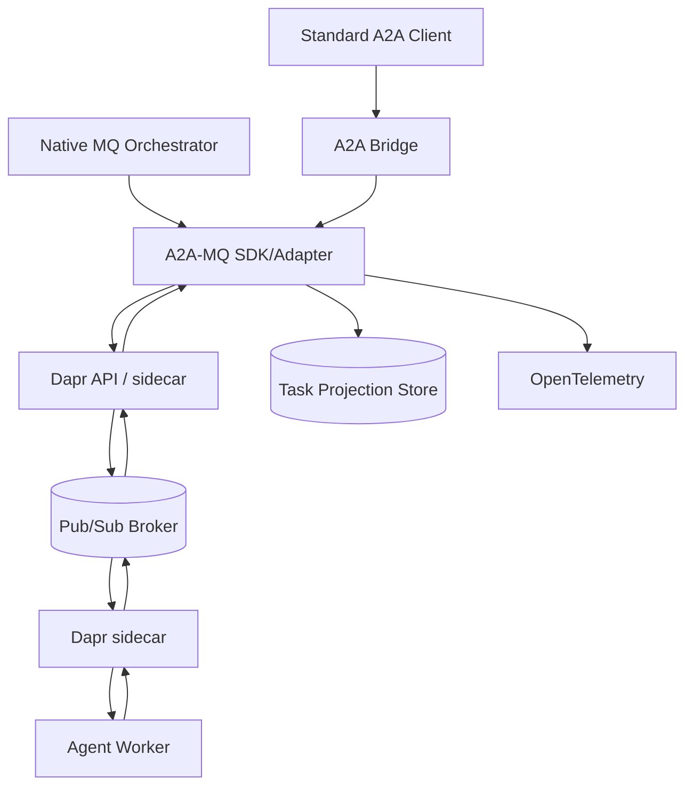

# Architecture

## 1. Overview

A2A-MQ is a thin interoperability layer between A2A semantics and durable message infrastructure. It intentionally keeps the custom surface small.



Reference deployment uses Dapr Pub/Sub backed by NATS JetStream, Dapr Workflow for durable orchestrations and a Dapr-supported state store for task projections/workflow state.

## 2. Components

### 2.1 A2A Bridge

Purpose: interoperability with existing A2A clients.

Responsibilities:

- expose a pinned upstream A2A server binding;
- translate inbound A2A requests into A2A-MQ commands;
- wait or return immediately according to A2A request configuration;
- implement task retrieval/list/cancel against the task projection and command bus;
- map MQ events back to A2A streaming responses where practical;
- expose Agent Card information.

The bridge is stateless except for connection-local streaming state. Durable state belongs in workflow/task storage.

### 2.2 A2A-MQ Adapter/SDK

Purpose: project-specific protocol implementation.

Responsibilities:

- validate/serialize A2A payloads;
- construct/version envelopes;
- choose logical command/event route;
- attach correlation, causation and trace context;
- encrypt/decrypt payloads when enabled;
- deduplicate inbound commands;
- validate task state transitions;
- publish canonical lifecycle events;
- update task projections transactionally/idempotently;
- normalize broker/runtime failures into documented error classes.

The adapter SHOULD be implemented first in Python because Dapr Agents is Python-first and the target use cases are agent-heavy. The protocol schema must remain language-neutral.

### 2.3 Dapr Runtime

Dapr provides:

- pub/sub API and broker abstraction;
- service identity/mTLS in Daprized deployments;
- pub/sub scopes;
- workflow engine;
- resiliency configuration;
- secrets and state-store interfaces;
- telemetry integration.

Application code SHOULD NOT import NATS-specific client code on the reference path.

### 2.4 Broker

NATS JetStream is the reference broker. Required broker properties:

- persistence;
- acknowledgements/redelivery;
- competing consumers;
- fan-out subscription identities;
- bounded retention;
- operational metrics;
- clustered production mode.

The abstraction assumes at-least-once delivery.

### 2.5 Worker / Agent

A worker owns one or more capabilities. It subscribes to command routes and invokes agent/application logic.

Workers must:

- be restart-safe;
- validate destination/capability before work;
- deduplicate before non-idempotent actions;
- persist or emit state before acknowledging the command according to the processing policy;
- surface progress as A2A task updates;
- treat cancellation/interruption as normal lifecycle events.

### 2.6 Task Projection

The projection stores the latest canonical task representation plus ordering/version metadata.

Minimum record:

```text
task_id
context_id
state
state_version
last_event_id
updated_at
serialized_task
owner_agent_id
routing_key
```

Optional secondary indexes support list/filter queries. Full event sourcing is not required for MVP; the broker/event retention and structured logs provide operational history, while the projection provides query efficiency.

### 2.7 Durable Workflow

Use Dapr Workflow for tasks needing:

- long waits;
- child tasks;
- retries across process restarts;
- `INPUT_REQUIRED` / `AUTH_REQUIRED` pauses;
- cancellation coordination;
- fan-out/fan-in.

Simple short-lived tasks MAY execute without a workflow instance if their correctness does not require durable orchestration, but the external A2A semantics remain identical.

## 3. Logical topic model

Logical names below are broker-neutral. Dapr component configuration maps them to backend subjects/queues.

| Topic | Semantics | Consumer pattern |
|---|---|---|
| `a2a.command.agent.<agentId>` | Direct work for an agent/pool | Competing |
| `a2a.command.skill.<skill>` | Work routed by capability | Competing |
| `a2a.command.control` | Control-plane commands if enabled | Restricted competing |
| `a2a.event.task` | Task status lifecycle | Fan-out |
| `a2a.event.artifact` | Artifact updates | Fan-out |
| `a2a.event.agent` | Agent/capability announcements | Fan-out |
| `a2a.event.audit` | Sanitized audit/security events | Fan-out/restricted |
| `a2a.dlq.command` | Dead command messages | Operator-only |
| `a2a.dlq.event` | Dead event messages | Operator-only |

### Why not one topic per task?

Creating a topic/consumer per task causes control-plane churn, cleanup complexity and broker-specific scaling behavior. Task correlation belongs in envelope fields. Topic cardinality should scale with domains/agents/capabilities, not with every unit of work.

## 4. Consumer identities

A consumer identity is stable across restarts.

Examples:

- worker replicas for `invoice-analysis` share consumer identity `worker-invoice-analysis`;
- orchestrator `planner-a` consumes task events with `orchestrator-planner-a`;
- audit service uses `audit-v1`.

Shared identity = competing consumption. Distinct identity = fan-out observation.

## 5. Data planes

### 5.1 Command plane

Commands cause work or lifecycle control. They require strict destination authorization, deduplication and DLQ handling.

### 5.2 Event plane

Events report immutable observations: state change, artifact chunk, capability change. Observers must tolerate duplicate and stale/out-of-order delivery.

### 5.3 Query plane

`GetTask` and `ListTasks` are projection queries, not broker scans. This keeps latency predictable and avoids coupling query semantics to retention configuration.

## 6. State transition authority

A task has one logical execution authority at a time: the assigned worker/workflow. Multiple orchestrators may observe and request control actions, but they do not independently mutate task state.

The projection layer accepts an update only if:

- `taskId` matches;
- state version is newer than the stored version;
- transition is legal;
- event identity has not already been applied.

This protects against duplicate/out-of-order event delivery.

## 7. Routing

Routing happens in this order:

1. explicit target agent, if provided;
2. requested skill/capability;
3. configured policy/dispatcher;
4. reject as unroutable.

The broker does not inspect natural-language content to choose workers. Any semantic routing belongs in an orchestrator/dispatcher and produces an explicit routing key.

## 8. Multi-tenant isolation

Three levels are supported conceptually:

1. **Soft namespace**: tenant prefix + Dapr scopes. Suitable for trusted internal environments.
2. **Broker account/namespace isolation**: separate NATS accounts or equivalent backend boundary. Preferred for stronger enterprise isolation.
3. **Separate clusters**: highest isolation/regulatory boundary.

Payload encryption may be layered on any of these.

## 9. High availability

Production topology:

- broker cluster with persistent storage;
- at least two bridge replicas;
- at least two replicas for stateless adapter services where applicable;
- external production state store supported by Dapr Workflow/projection implementation;
- stable consumer identities;
- health/readiness gating;
- OpenTelemetry collector outside individual application lifecycle.

A worker pool may intentionally contain a single replica when the underlying operation cannot be parallelized, but durability should still not rely on its process memory.

## 10. Failure handling

| Failure | Expected behavior |
|---|---|
| Worker offline | Command remains durable until retention/expiry |
| Worker crashes before ack | Command redelivered |
| Worker crashes after side effect | Dedup/idempotency prevents unsafe repetition |
| Event duplicate | Projection ignores duplicate event ID |
| Event arrives stale | Projection ignores lower/equal state version |
| Broker unavailable | Publisher gets transient error/retry policy; no fake success |
| Projection unavailable | Do not ack state-changing command until safe persistence policy satisfied |
| Poison command | Bounded retry then DLQ |
| KMS unavailable in encrypted mode | Fail closed; retry without exposing plaintext |
| Orchestrator crashes | Other work continues; events remain available per subscription retention |

## 11. Deployment modes

### Local developer

- single NATS with JetStream;
- Dapr local mode;
- SQLite/local supported state store;
- no external KMS; development key provider only;
- Docker Compose/task runner.

### Team / integration

- clustered or managed broker;
- shared state store;
- real secret store;
- mTLS enabled;
- dedicated namespaces/accounts.

### Production

- HA broker and state store;
- workload identity;
- least-privilege Dapr scopes;
- real KMS/key wrapping if payload encryption enabled;
- OTEL collector and alerts;
- backup/restore procedures;
- explicit retention and DLQ policies.

## 12. Source layout target

```text
src/a2a_mq/
  envelope.py
  codec.py
  routing.py
  transitions.py
  dedup.py
  crypto.py
  publisher.py
  consumer.py
  projection.py
  errors.py
  bridge/
    http_json.py
  dapr/
    pubsub.py
    workflow.py
examples/
  orchestrator/
  worker/
  encrypted_worker/
tests/
  unit/
  integration/
  conformance/
  chaos/
spec/
deploy/
docs/
```

This structure is a target for implementation, not an excuse to add abstraction before tests demand it.
