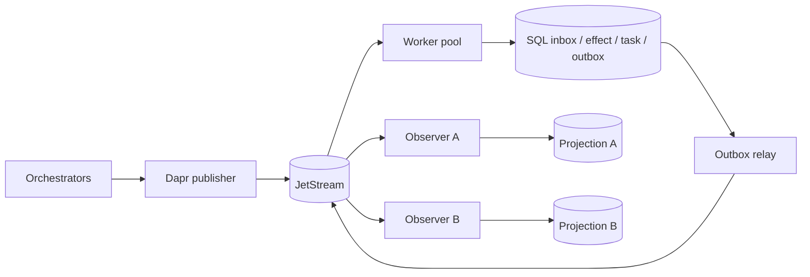

# Architecture - revision 2

## Boundaries and ownership

Dapr provides the Pub/Sub API. JetStream provides retained delivery. Our SQL
transaction provides the application consistency boundary. These are different
promises: neither a broker ACK nor a Dapr sidecar proves a business effect occurred.
Dapr Workflow is integrated in phase 4, not emulated by a home-grown workflow engine.

The worker pool is one logical task authority. Replicas share its database and
consumer namespace. A claim contains a lease and fencing token; recovery may
reclaim an abandoned claim, but a stale worker cannot commit through the old token.
A task's owner/source and context cannot change silently. Cross-owner transfers
require a later explicit handoff protocol.

## Transaction and ACK boundary

1. Validate size, schema, route and configured policy.
2. Atomically claim `(tenant, logical_consumer, message_id)` and store a content hash.
3. Commit the reference SQL effect, canonical task and outgoing events together.
4. Mark the inbox completed in that same transaction.
5. Return success to Dapr. A separate relay publishes the persisted outbox.

A crash after step 2 is recovered after lease expiry. A crash during step 3 rolls
back that transaction. A crash after step 4 cannot duplicate the reference effect.
A relay crash after publish but before marking sent can duplicate the event; this
is intentional and projection consumers deduplicate it. No distributed transaction
between SQL and the broker is claimed. See ADR 0003 and the failure matrix.

## Projection design

The initial implementation uses `task.snapshot` events carrying **complete A2A
Task objects**, including artifacts and bounded history. `sequence` orders full
snapshots per task, not broker deliveries. A higher snapshot may skip versions;
an older snapshot cannot erase a newer result. Same-version conflicting content,
changed owner/context and terminal rewrites are rejected. This fixes the old
adjacent-transition check, which could reject a completed task seen before working.

Pure-domain codecs also describe status/artifact deltas. They are not silently
applied as snapshots. Delta streaming requires buffering/reassembly in a later
phase. This trade-off spends some message bytes to avoid building an event-sourcing
engine for the first slice. Large artifacts stay in authorized object storage.

## Topology

`a2a.v1.<tenant>.command.agent.<agent>` and
`a2a.v1.<tenant>.command.skill.<skill>` are competing routes.
`a2a.v1.<tenant>.event.task` is the snapshot fan-out route.
`a2a.v1.<tenant>.dlq` is an operator route. No topic is created per task.
Identifiers are already canonical lowercase ASCII slugs; reject, never silently
lowercase, truncate, replace dots, or normalize Unicode.

Each Dapr component is scoped to an application role. Each subscribed filter has
its own durable consumer/group pair. Replicas share that pair; observers must not.
A single global `durableName` reused for different filters is not safe. Provision
a limits-retention stream before publishing, even when no workers exist yet.

## State backends

SQLite is a single-host development backend with WAL, busy timeout and full sync.
Do not put its file on NFS or present it as a multi-node production database.
PostgreSQL is the shared transactional backend; its live tests are a separate gate.
Task/inbox/outbox SQL is not Dapr Workflow actor state. The latter needs a separately
verified supported Dapr state component when phase 4 is implemented.

## Queries, back-pressure and recovery

Internal `get/list` calls read a named projection with mandatory tenant scope,
bounded keyset pagination and parameterized SQL. This is not yet the public A2A
HTTP binding. Observers are eventually consistent; an empty projection does not
prove a publish failed. Clients retain the command ID and retry the same envelope.

Bound request bytes, nesting, handler concurrency, publish timeout and list size.
Do not hold a broker callback open for hours. Long-running work must be durably
accepted by the workflow runtime in phase 4 before ACK. Admission, quota cleanup,
HA, migrations and retention are production gates, not inferred from local tests.
