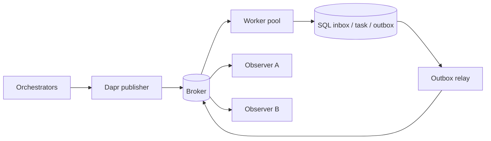

# Architecture - revision 4

## Product principle: local footprint first

A2A-MQ has two deployment concerns that are intentionally separate.

The **local bridge** must be cheap enough to remain beside local models and agent
tools on a resource-constrained host. The **distributed profile** pays for shared
durability, independent scaling, Workflow semantics and production infrastructure.

Resource viability is a product gate. The full Docker/Compose/Kubernetes stack is
an acceptance/distributed topology, not the default local runtime.

## Deployment tiers

### Core diagnostic

Python + SQLite only. `scripts/local_resource_probe.py` measures our own persistence
and domain cost before any broker/sidecar is started. It is diagnostic and does not
claim MQ parity.

### Local MQ Lite - implemented

`a2a_mq.local_lite` implements the default local tier:

```text
one Python A2A-MQ process
          |
        daprd
          |
  NATS JetStream

application state: SQLite
```

The `a2amq-local` launcher makes the Python launcher itself become the ASGI process,
so there is no fourth steady-state supervisor. NATS is provisioned by a short-lived
helper and then the steady process budget is exactly three.

This tier uses no PostgreSQL, Redis, Docker/Kubernetes, Vault, external OTLP,
Placement or Scheduler. It reuses the durable ledger, A2A bridge, Dapr Pub/Sub,
outbox, cancellation and DLQ/replay implementation.

It supports immediate deterministic tasks. Workflow-only waits, timers,
input/approval and fan-out/fan-in are explicitly rejected rather than implemented by
a second scheduler. API and immediate worker execution are intentionally collapsed,
so independently-offline worker-pool semantics are not claimed by this tier.

### Local Workflow - implemented, optional, not default

`a2a_mq.local_workflow` and `a2amq-local-workflow` implement the higher local
tier for durable waits/timers/approval/fan-out. API + Workflow remain in one Python
process and one sidecar. The tier adds native Placement and Scheduler plus a separate
Dapr `state.sqlite` actor/Workflow store, for a five-process steady-state target.

It still uses no PostgreSQL, Redis, Docker/Kubernetes, Vault or external OTLP.
The official Dapr Workflow runtime, existing `DaprActions`, controls, reconciliation,
outbox and TaskLedger are reused; no second workflow engine is implemented.

This tier has a separate, higher resource budget and never replaces local-lite by
default. Its native target-machine gate remains required.

### Distributed / production

The role-separated `a2a_mq.application` profile retains API, Workflow workers,
observers and operator roles; shared PostgreSQL; production broker/state backends;
HA, transport protection and observability integrations.

## Distributed boundaries and ownership



Dapr provides the Pub/Sub API. The broker provides retained delivery. SQL provides
the application consistency boundary. A broker ACK or Dapr callback does not by
itself prove a business effect occurred.

Distributed worker replicas share a database and logical consumer. Claims use
leases/fencing; stale workers cannot commit through an old fence. Task owner/source
and context cannot silently change.

## Transaction and ACK boundary

1. Validate size, schema, route and policy.
2. Atomically claim the namespaced immutable message identity.
3. Commit task/effect/outgoing event state transactionally.
4. Persist completion and outbox state.
5. ACK transport only after durable admission/effect boundaries are satisfied.
6. Relay persisted outbox records separately.

A crash after publication but before marking may duplicate an event; consumers
deduplicate. No SQL/broker distributed transaction is claimed.

## Local-lite execution boundary

Local-lite still routes admitted commands through real Dapr Pub/Sub/JetStream. A
Dapr callback records a durable start action in the existing TaskLedger. The local
executor handles only immediate deterministic work and writes ordinary TaskLedger
steps/outbox events. It records terminal runtime completion for the same retention
and recovery gates used elsewhere.

This executor is not a Workflow substitute. Requests requiring durable waits or
Workflow controls fail closed with `WORKFLOW_FEATURE_UNAVAILABLE`.

## Projection design

Complete `task.snapshot` events carry canonical A2A Task objects. `sequence`
orders snapshots per task. Higher snapshots may skip versions; older snapshots may
not erase newer state. Same-version conflicts, owner/context changes and terminal
rewrites are rejected.

## Topic topology

`a2a.v1.<tenant>.command.agent.<agent>` and skill routes are command routes.
`a2a.v1.<tenant>.event.task` carries task snapshots.
`a2a.v1.<tenant>.dlq` is the operator/dead-letter route.

Local-lite uses two Dapr views of the same JetStream stream: a command component and
a read-only DLQ component with a distinct durable consumer. This avoids sharing one
durable identity across different subscription filters without adding another
process.

## State backends

SQLite is the preferred single-host application backend with WAL and full sync. It
stays on a local filesystem. PostgreSQL is for distributed replicas and is not a
local-product prerequisite.

Dapr Workflow state is separate from the A2A-MQ inbox/task/outbox database. The
implemented local Workflow tier uses a scoped Dapr SQLite Actor/Workflow state
component; the distributed profile may use production state infrastructure.

## Back-pressure and resource boundaries

Requests, message depth, handler concurrency, database work queues, publication,
record counts and page sizes are bounded.

Local-lite additionally bounds:

- one application worker;
- concurrency default 2;
- SQLite database queue default 4;
- 128 active / 10,000 retained task defaults;
- single-node JetStream with bounded memory/file/stream limits;
- three steady-state product processes.

`scripts/local_stack_probe.py` measures either prepared local profile. Local-lite
expects three processes; local-workflow expects five and is judged against its own
higher budget. Raising machine requirements is not a substitute for a failed local
resource gate.
