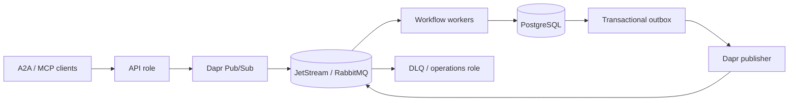

# Architecture — revision 5 (v0.1.0-rc2)

## Design principle: local footprint first

A2A-MQ separates three deployment tiers rather than forcing a distributed stack onto
every user:

1. **Local-lite** — smallest practical single-host durable queue path;
2. **Local Workflow** — optional single-host Dapr Workflow semantics;
3. **Distributed / production** — role-separated services and shared infrastructure.

The tiers reuse the same core contracts but make different availability and
infrastructure trade-offs. Local-lite must not silently grow into the Workflow or
distributed topology.

## Local-lite

```text
Browser / A2A client
        |
        v
+---------------------+
| A2A-MQ Python app   |
| A2A bridge          |
| TaskLedger / outbox |
| SQLite              |
+----------+----------+
           |
           v
        daprd
           |
           v
   NATS JetStream
```

Steady-state product processes:

- A2A-MQ Python app;
- `daprd`;
- `nats-server`.

SQLite is the application consistency boundary. Commands still traverse real Dapr
Pub/Sub and JetStream before local execution.

Local-lite supports immediate deterministic work. Durable waits, approval/input
continuation, delays/timers and fan-out/fan-in fail closed with
`WORKFLOW_FEATURE_UNAVAILABLE`.

Queue Lab is embedded in the same Python process at `/lab/`; it is a client/test
surface over existing A2A and operations APIs, not a second backend.

## Optional local Workflow

```text
Browser / A2A client
        |
        v
+---------------------+
| A2A-MQ Python app   |
| A2A + Dapr Workflow |
| TaskLedger / outbox |
+----------+----------+
           |
           v
        daprd
       /     \
      v       v
 JetStream  Dapr Workflow state
              |
      Placement + Scheduler
```

Steady state adds native Dapr Placement and Scheduler for five processes total.
A2A-MQ application state and Dapr Workflow state remain separate SQLite stores.

The official Dapr Workflow runtime is reused. A2A-MQ does not implement a competing
workflow engine.

## Distributed / production profile

The distributed profile separates API, Workflow worker and DLQ/operations roles.
Shared infrastructure can include:

- PostgreSQL for application consistency;
- JetStream or RabbitMQ behind Dapr Pub/Sub;
- Dapr Workflow state/control plane;
- authenticated A2A and MCP endpoints;
- optional Vault Transit payload protection;
- telemetry and operator-managed Kubernetes infrastructure.



## Consistency boundary

A broker ACK is not a business commit.

For accepted work:

1. validate schema, identity, route and authorization;
2. atomically record/claim immutable work identity in the application store;
3. commit task/effect/outbox state transactionally;
4. ACK transport only after the required durable boundary has succeeded;
5. publish persisted outbox records separately.

A crash after publication but before the local sent marker can produce a duplicate
event. Stable event identity and consumer deduplication handle that case. A2A-MQ does
not claim a SQL/broker distributed transaction or generic exactly-once external
effects.

## Leases and fencing

Distributed workers sharing one logical consumer can reclaim expired work. A newer
claim receives a newer fence; a stale worker cannot commit through an old fence.

Task owner, tenant, context and immutable request identity cannot silently change
during retry/replay.

## Local-lite pause boundary

Queue Lab's Local-lite pause control sets a delivery boundary before
`ledger.accept`. Work may still be durably admitted and published while acceptance
is paused. The in-flight hold is bounded; if pause remains active, the normal retry
path is returned and broker/Dapr redelivery remains authoritative.

This exists only for local testing and does not change the production delivery
contract.

## Task projections

Task state is represented as canonical full snapshots with an increasing sequence.
Newer snapshots may skip versions; older snapshots cannot erase newer state.
Conflicting same-version data, owner/context changes and terminal rewrites are
rejected.

Full snapshots trade bandwidth for simpler recovery and are deliberate in v0.1.0.

## Topic topology

Important route families include:

- `a2a.v1.<tenant>.command.agent.<agent>`;
- command skill routes where configured in distributed profiles;
- `a2a.v1.<tenant>.event.task`;
- `a2a.v1.<tenant>.dlq`;
- local poison-message parking routes.

Local-lite scopes its Dapr resources to the profile's configured command route and
uses a distinct DLQ consumer view.

## State backends

### Local-lite

- A2A-MQ state: SQLite, WAL, `synchronous=FULL`;
- broker state: JetStream files.

### Local Workflow

- A2A-MQ state: SQLite;
- Dapr Workflow/actor state: separate Dapr SQLite state store;
- Scheduler persistence: local scheduler state;
- broker state: JetStream files.

### Distributed

- application state: PostgreSQL;
- Dapr Workflow state: production Dapr state component;
- broker: JetStream or RabbitMQ profile.

## Back-pressure and quotas

The implementation bounds request/body size, callback concurrency, database work,
active/retained tasks, page sizes, retry behavior and local broker retention.

Local-lite defaults include:

- callback concurrency: 2;
- SQLite work capacity: 4;
- active task limit: 128;
- retained task limit: 10,000;
- JetStream message/file limits;
- exactly three steady-state processes.

The optional Workflow tier has its own larger resource budget and must not replace
Local-lite simply because it is available.

## Security boundary

Built-in local profiles bind loopback and generate owner-private credentials. They
are not a production trust boundary.

Distributed production deployments require administrator-managed TLS, identity,
broker/database credentials, Dapr control plane and network policy. Optional payload
encryption adds confidentiality/authenticity but does not replace authorization or
delivery/idempotency rules.

See [SECURITY.md](SECURITY.md).

## Evidence boundary

Architecture describes the implemented contracts; validation remains SHA-bound.

- RC2 local/Queue Lab/Workflow evidence:
  [validation/queue-lab-rc2-20260927.md](validation/queue-lab-rc2-20260927.md)
- earlier full acceptance and Kubernetes evidence:
  [VALIDATION.md](VALIDATION.md)

No architecture statement should be read as a claim of third-party certification,
generic exactly-once behavior, HA SLA or unmeasured performance.
