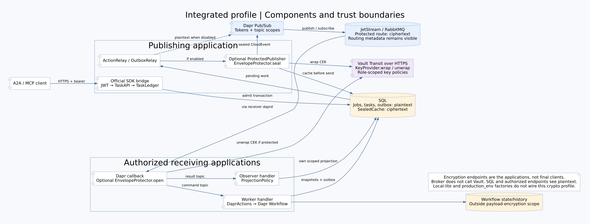
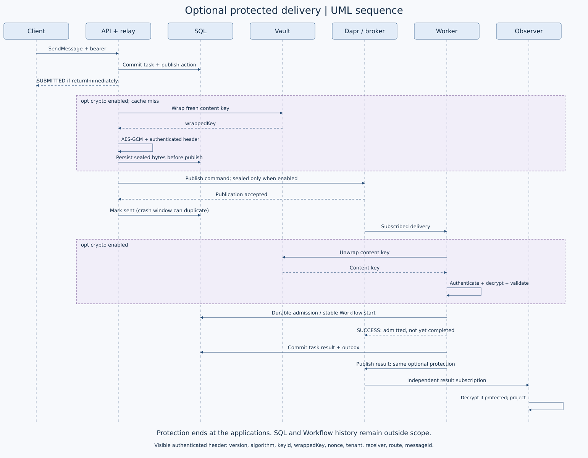

# Optional payload protection

A2A-MQ implements application-level authenticated envelope encryption across the
messaging transport. Enable it explicitly in the integrated distributed profile.
It is not enabled by installing the security extra: that extra also supplies JWT
support for ordinary local profiles.

## Choose the correct entry point

| Profile | Payload encryption | Operations API |
|---|---|---|
| Local-lite / local Workflow | Not wired into these local profiles | /operations |
| application:from_env with A2A_CRYPTO_CONFIG | Protected command/event publication and protected callbacks | /operations |
| production_env:create_*_from_env | Not supported; an explicit nonempty A2A_CRYPTO_CONFIG is rejected | /ops |

The last row has its own maintained deployment recipe. Do not mix its variable
names with the integrated profile below. Both are existing compositions; neither
is silently converted into the other.

## Integrated profile recipe

The following identifiers and paths are examples, not issued credentials or an
already-provisioned deployment. Supply operator-managed TLS Vault Transit, key
policies, PostgreSQL, broker and Dapr infrastructure before starting the service.

Run the existing factory with the existing `deploy/Dockerfile.full` image:

```bash
python -m uvicorn a2a_mq.application:from_env --factory \
  --host 0.0.0.0 --port 8000 --no-access-log
```

Do not substitute `deploy/production/Dockerfile`: it starts the other composition.
Configure these real `Settings.from_env` inputs for each role:

| Variable | Value / requirement |
|---|---|
| A2A_ROLE | api, workflow, observer or operator |
| A2A_TENANT | Same tenant for the corresponding routes |
| A2A_CONSUMER | tasks for API/workflow/operator; distinct scope per observer |
| A2A_SOURCE | workflow-worker, matching the configured command target |
| A2A_COMPONENT | Role-local Dapr component, e.g. bus-api or bus-workflow |
| A2A_POSTGRES_DSN_FILE | Owner-private file; verified-TLS PostgreSQL in production |
| APP_API_TOKEN_FILE | Role-specific Dapr-to-app token file |
| DAPR_API_TOKEN_FILE | Role-specific app-to-Dapr token file |
| DAPR_HTTP_ENDPOINT | Colocated loopback sidecar |
| A2A_PUBLIC_URL | HTTPS origin for API/operator |
| A2A_JWT_ISSUER | HTTPS issuer for API/operator |
| A2A_JWT_KEYS_FILE | JSON map from kid to public PEM, never a private key |
| A2A_ENABLE_MCP | 0 or 1; only the API role |
| A2A_CRYPTO_CONFIG | Path to the JSON below |

This profile uses A2A_COMPONENT, JWT_KEYS_FILE, 0/1 booleans and /operations.
The other production_env profile uses A2A_PUBSUB_COMPONENT, JWT_KID plus
JWT_PUBLIC_KEY_FILE, true/false booleans and /ops. They are not interchangeable.

Example crypto configuration, containing no actual credential:

```json
{
  "vaultUrl": "https://vault.example",
  "tokenFile": "/credentials/vault-token",
  "caFile": "/broker-ca/ca.crt",
  "mount": "transit",
  "namespace": "",
  "command": {
    "receiver": "workers",
    "active": "commands-v1",
    "keys": [{"id":"commands-v1","name":"a2amq-commands","writeVersion":1,"minReadVersion":1}]
  },
  "event": {
    "receiver": "observers",
    "active": "events-v1",
    "keys": [{"id":"events-v1","name":"a2amq-events","writeVersion":1,"minReadVersion":1}]
  }
}
```

Both command/event sections are required even when a role uses only one direction.
Provision Vault policy for the actual calls: API wraps command keys; workflow unwraps
command keys and wraps event keys; observers unwrap event keys; the replay operator
unwraps both to revalidate archived messages. Receiver names are logical groups,
not individual publisher signatures. Supplying this JSON does not create Vault
keys, grant permissions or provision TLS.

The existing integrated Kubernetes renderer accepts a `cryptoConfigMap`:

```bash
python -m a2a_mq.deployment kubernetes \
  --config integrated-config.json --output integrated-manifests.json
```

Its configuration requires namespace, digest-pinned image, broker, TLS brokerEndpoint,
HTTPS publicUrl/issuer, redisHost and explicit egressCIDRs. Add cryptoConfigMap naming
a ConfigMap with a `crypto.json` key. Each app also needs its own
`<appid>-vault-token` Secret with a `token` key. The image must start
application:from_env; the renderer does not provision the external infrastructure.
Review generated manifests before deployment. The three-role
`deploy/production/generate.py` renderer does not enable this profile.

### Rotation and queued data

Retain readable key versions until queued messages and authorized replays no longer
need them. active selects new writes; minReadVersion/writeVersion bound reads.
Retiring a needed version makes those messages undecryptable.

FileToken rereads its configured file, but the integrated Kubernetes renderer copies
projected secrets into a memory volume in its initContainer. Updating the original
Secret does not refresh that copy: perform an authorized rollout to load it. Crypto
configuration is also loaded at startup. Do not promise hot rotation from changing
the source Secret alone.

## Cryptographic and trust boundary

EnvelopeProtector generates a fresh 256-bit content key and 12-byte nonce for each
new sealed envelope. AES-256-GCM encrypts the canonical Envelope. Vault Transit
wraps/unwraps the content key over verified HTTPS; the wrapping key remains in Vault.
SealedCache stores ciphertext before publishing, preserving identical bytes across
publication retries. The receiving application unwraps, authenticates, decrypts
and validates the envelope before handling it. Protected callbacks reject plaintext.

The authenticated header contains version, algorithm, keyId, wrappedKey, nonce,
tenant, receiver, route and messageId. These values are visible. CloudEvent routing,
source/type/time/ID and trace metadata also remain visible. AEAD authenticates the
group's content, not the individual publisher: authorized key users may forge group
messages. Workload identity, broker permissions and Vault policy remain necessary.

End-to-end here means the publishing and receiving A2A-MQ application components
across Dapr/broker. The public API and authorized receiver see plaintext; this is
not a client-to-client secrecy claim against those components or their database
operators. LocalKeyRing is for development/tests, not a production KMS.

## Data boundaries

| Location | Data visible there |
|---|---|
| Client → public API | A2A request readable by API; HTTPS transport protection |
| SQL jobs/actions/outbox/projections | Plaintext envelope/results; no database encryption provided here |
| SealedCache | Persisted ciphertext and hashes, alongside separate plaintext records |
| Dapr / broker on protected routes | Ciphertext plus visible routing and CloudEvent metadata |
| Vault Transit | Content key during wrap/unwrap; wrapping key remains in Vault |
| Authorized worker / observer | Plaintext after authenticated decryption |
| Workflow history | May contain plaintext input/output; separate deployment responsibility |
| Protected DLQ/replay | Original ciphertext for protected messages; rejected plaintext/raw input may also be archived. Authorized replay decrypts protected messages to revalidate |
| Logs / metrics | Identifier/reason-oriented contract, not metadata anonymity |

## Verify activation, not just installation

- Confirm the running factory is application:from_env and A2A_CRYPTO_CONFIG points
  to the intended configuration in every participating role.
- Verify command/event publications use application/vnd.a2amq.sealed+json and the
  broker copy has ciphertext rather than the clear Envelope. Do not publish secrets
  or private payloads as test evidence.
- Verify successful authorized receipt, rejection of plaintext/tampering/wrong scope,
  and unchanged ciphertext on retry. A health check alone does not prove encryption.
- Retain key versions for queued and archived messages. Replay revalidates and
  republishes original ciphertext; it does not invent a new message identity.

Existing crypto tests exercise these contracts, while historical real Vault and
broker gates have separate evidence scopes. Separate successful gates alone do not
prove a combined encrypted broker journey on the current source. See
[Validation](VALIDATION.md) and [Security](SECURITY.md).




Editable Graphviz sources and reproduction commands are in [diagrams](diagrams/README.md).
