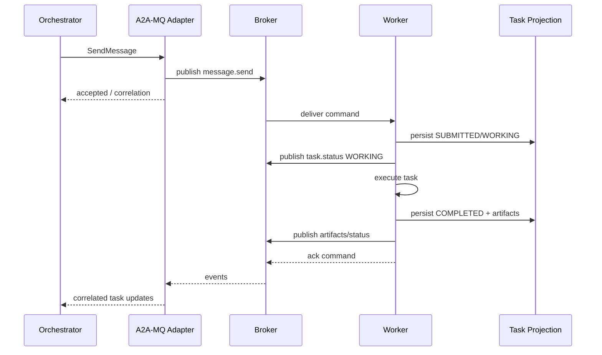
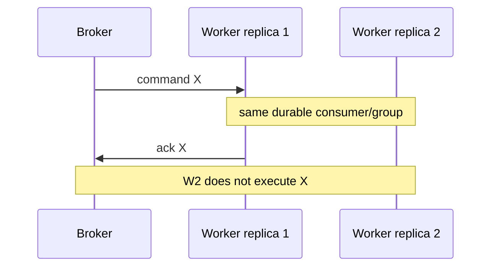
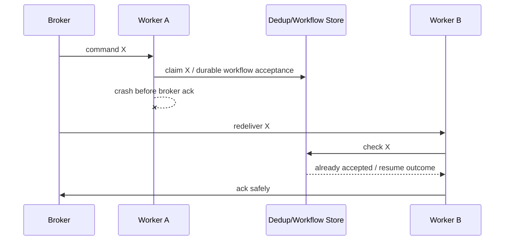
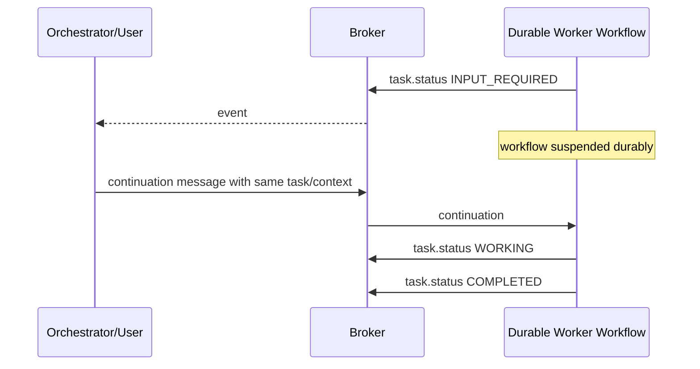
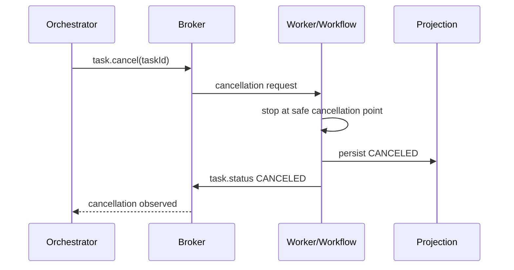
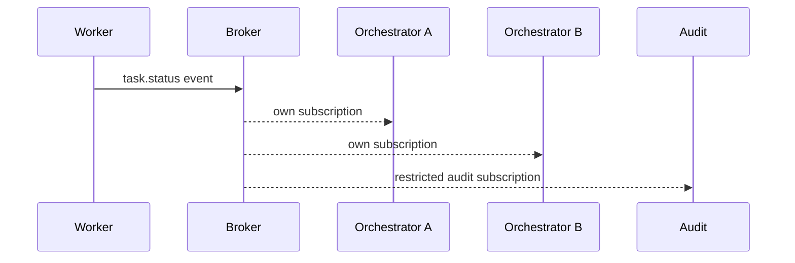
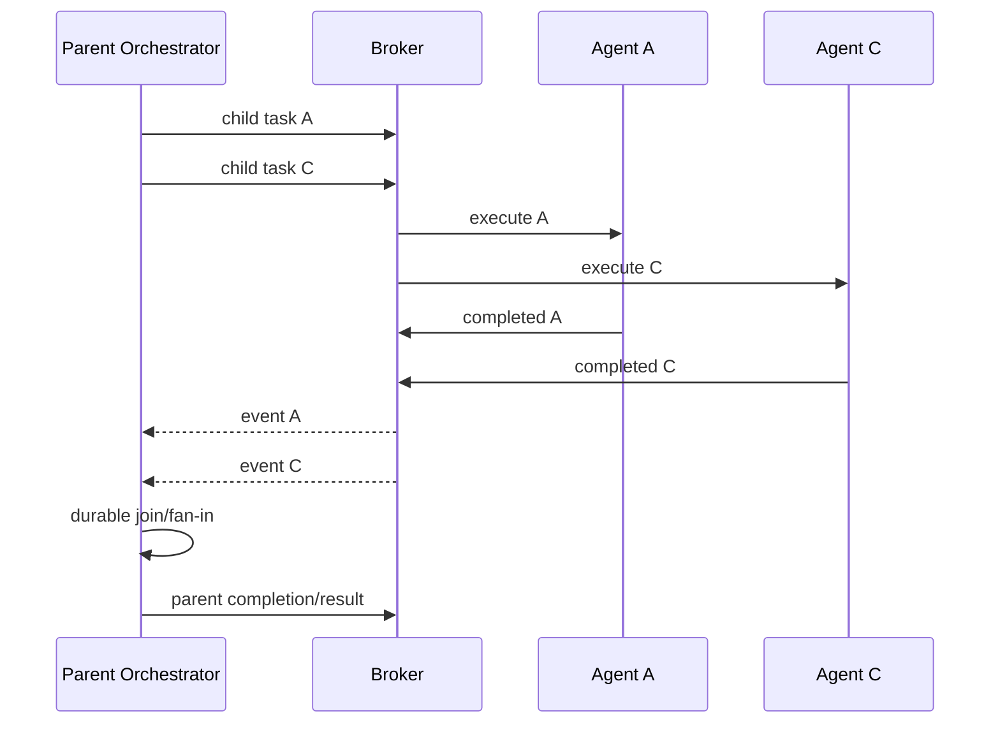
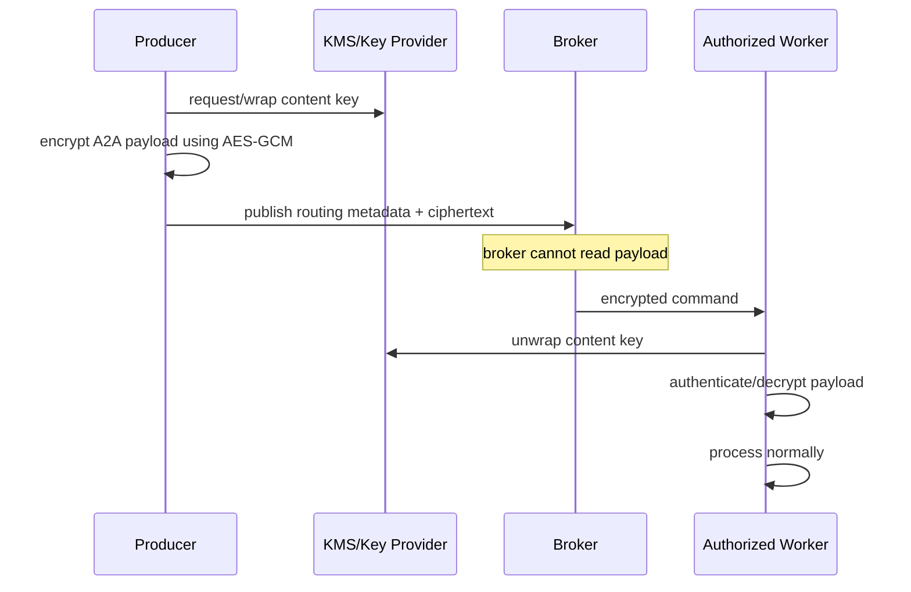
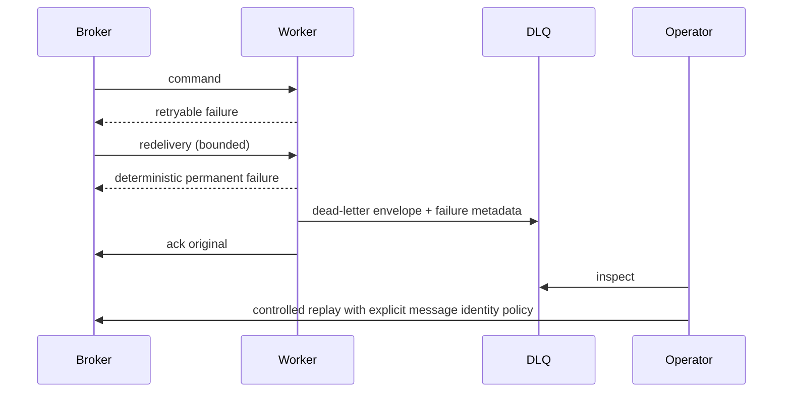
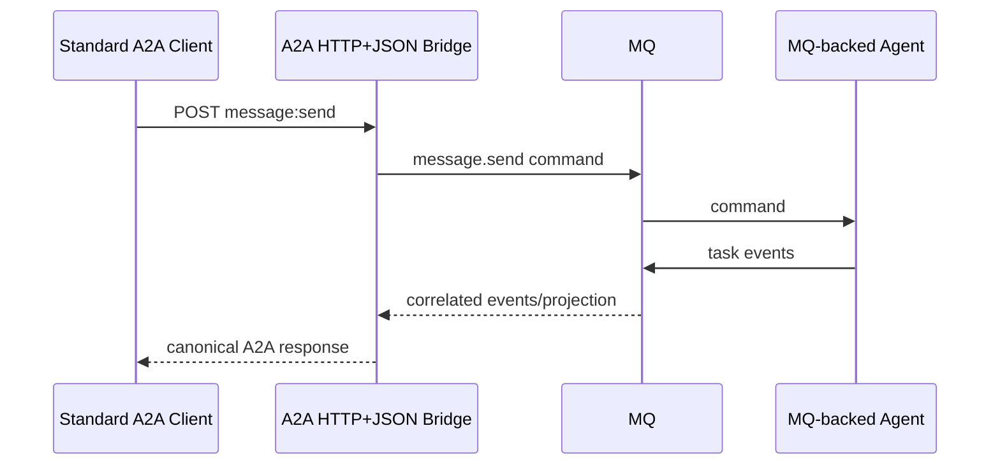

# Workflows

## 1. Basic asynchronous task



## 2. Worker offline at submission

```mermaid
sequenceDiagram
    participant O as Orchestrator
    participant B as JetStream
    participant W as Worker
    O->>B: durable command
    Note over B: worker unavailable; command retained
    W->>B: reconnect durable consumer
    B->>W: deliver pending command
    W->>B: ack after durable acceptance/outcome
```

Expected property: no task loss merely because a worker was temporarily offline.

## 3. Competing workers



The application still implements deduplication because redelivery can happen after crashes/timeouts.

## 4. Crash and redelivery



## 5. Input required



`AUTH_REQUIRED` follows the same pattern, with authorization material handled by secure references rather than plaintext secrets in task content.

## 6. Cancellation



Race rule: if completion becomes durable before cancellation is accepted, terminal `COMPLETED` wins. Terminal states are not rewritten by a later stale cancellation event.

## 7. Multi-orchestrator fan-out



Each observer has an independent consumer identity, so one observer receiving an event does not consume it on behalf of the others.

## 8. Orchestrator fan-out/fan-in



The parent workflow stores child task IDs/reference relationships using A2A-compatible task/message metadata.

## 9. Encrypted command



## 10. Poison message and DLQ



## 11. Standard A2A bridge



For streaming, the bridge maintains the client stream while consuming correlated task events. If the bridge restarts, the client follows normal A2A reconnection/subscription semantics; task durability does not depend on the stream connection.
