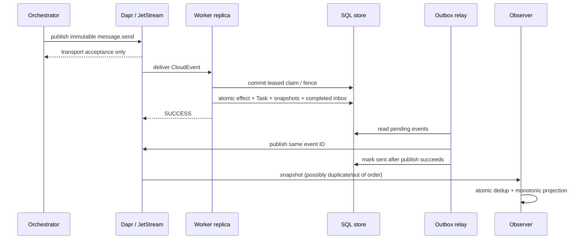
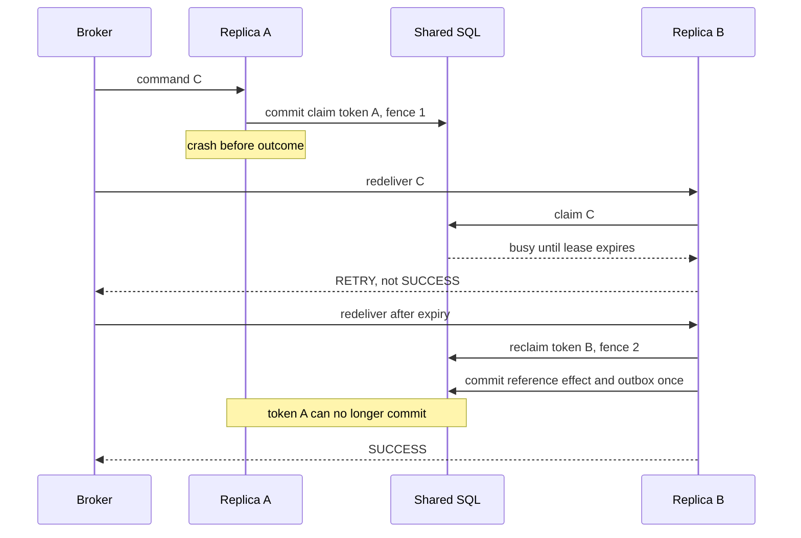

# Workflows and failure boundaries

## Normal reference task (phases 2-3)

## Crash after claim

A committed claim is not an accepted durable workflow. A worker must never ACK an
unfinished claim just because the message was seen before. Long tasks transition
to the Dapr Workflow acceptance boundary only when phase 4 implements it.

## Effect and relay crash matrix

| Crash point | Durable result | Recovery |
|---|---|---|
| Before claim commit | Nothing reserved | Redelivery can claim |
| After claim commit | Lease only | Retry, then fenced takeover |
| After effect SQL, before transaction commit | Effect/outcome rollback | Reclaim and execute local effect |
| After outcome commit, before ACK | Completed inbox and outbox | Return existing outcome; no second effect |
| After event publish, before sent marker | Event may be delivered twice | Republish same ID; observers deduplicate |

## Offline and multi-orchestrator behavior

Provision a retained stream first. Commands published before workers exist remain
available within retention; worker replicas share one durable/group. Observer A and
B each have their own durable/group and projection namespace. A shared group would
load-balance observers rather than broadcast, so configuration tests reject that.
A late observer can rebuild from retained full snapshots; retention still limits
history. Database backups are needed after all retained snapshots are gone.

## Snapshot reordering

For task T, version 3 completed may arrive before versions 1 submitted and 2 working.
Apply the complete version-3 Task, including artifacts. Later lower versions cannot
replace it. Conflicting version 3 or a higher snapshot reopening T is rejected.
This rule applies to full snapshots, not incremental artifact chunks.

## Future workflows (not implemented in phases 0-3)

Input/auth-required pauses need a durable workflow and a continuation message with
the same task/context. Cancellation is a request until the owner durably stops;
completion already committed cannot be rewritten. Fan-out/fan-in stores child IDs
and join state durably rather than relying on observer process memory. The standard
A2A bridge converts these events to upstream responses/streams in phase 5.

Encrypted flow in phase 7: authorize recipient, wrap a fresh content key, AEAD-encrypt,
publish, authenticate/decrypt at the authorized endpoint, then follow the same
inbox/outbox rules. Encryption does not change delivery or idempotency semantics.
